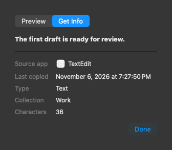
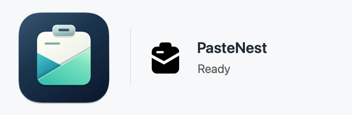
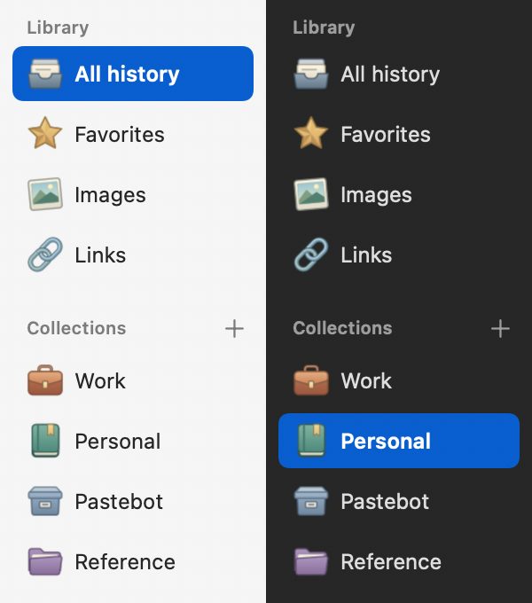

<p align="center"></p>

# PasteNest

A local clipboard history for macOS. Open the menu-bar picker, find something you copied, and click once to paste it back into the app you were using.

**[Download PasteNest 1.6 for Apple Silicon](https://github.com/shrotshahariar/PasteNest/releases/download/v1.6.0/PasteNest-1.6-macOS-arm64.zip)** · [Release notes and checksum](https://github.com/shrotshahariar/PasteNest/releases/tag/v1.6.0)

<p></p>

## Getting started

1. On an Apple Silicon Mac running macOS 13 or later, download the ZIP, extract it, and move **PasteNest.app** to Applications.
2. Launch PasteNest and copy some text, a link, or an image.
3. Press **⌘⇧Space**. Search or use the arrow keys, then click a row or press Return. The picker opens on the display under your pointer.

For automatic insertion, allow the installed app under **System Settings → Privacy & Security → Accessibility**. Some macOS versions call this **Device Control and Data Access**. You can also use **Copy** and paste manually. This release is ad-hoc signed and has not been notarized by Apple. Gatekeeper may block the downloaded build.

## Drag and drop

Drag a history row into Finder, an attachment area or another compatible app. A copied selection of files travels together, with each original file offered separately. Dragging requests a copy operation. Files must still exist at their original locations. Text, URLs, images and app-specific formats can be dropped into destinations that accept them. Click a row to paste normally.

## Get Info

Open a clip’s **…** menu or right-click it, then choose **Get Info**. Use **Preview** to read the clip and **Done** to return to the picker.

<p></p>

## In the menu bar

The folded-paper icon shows when a clip reaches your history. A sheet slips into the pocket and turns into a brief checkmark. Pausing capture shows two steady bars. With macOS Reduce Motion enabled, successful copies show the checkmark immediately.

<details><summary>Preview the menu-bar icon in motion</summary>



</details>

## Text filters

Open the **…** menu on a text or link clip and choose **Paste with Filter**. Extract Web Links and Extract Email Addresses paste each distinct match on a new line, in its original order. Markdown Blockquote prefixes each line with a quote marker. Filtering runs on your Mac and preserves the original clip.

## In the picker

The picker opens with a library sidebar. Click a collection or a library filter to narrow the list. Look for the leather folio for Work, the bookmarked journal for Personal, and the archive box for Pastebot imports. Other collections have tabbed folders with a color that stays consistent across launches. Rows show the clip and its source app icon. Choose **… → Get Info** for the source app name, last copied date and time, clip type, and collection. Text and links also show a character count. Switch to **Preview** in the same popover to see the content. The sidebar button beside Search switches between library and compact views and remembers your choice.

- Search by text, source app, or collection. Source logos help distinguish similar entries.
- Use a row’s **…** menu to preview, favorite, organize, or delete a clip.
- Choose **Paste as Plain Text** in a text or link’s row menu to paste without formatting.
- Open the gear to choose a shortcut, switch appearance, pause capture, or ignore an app.
- Click outside to dismiss. Capture continues in the menu bar until you quit.

<details><summary>Library and collection icons in light and dark</summary>



</details>

## What is stored

PasteNest saves each readable copy on your Mac, including repeats, personal text, and copies marked sensitive. Rich text, images, file references and multi-item selections keep their readable clipboard formats. PasteNest checks the current clipboard on launch and retries delayed data while running. macOS supplies only the current clipboard, so an item overwritten between checks can be missed.

**Settings → Pause capture** stops all recording. **Skip sensitive copies** skips recognized sensitive sources and clipboard markers. Use **Ignored apps** to exclude individual apps. Unmarked personal text can still enter history while capture is enabled.

History stays in `~/Library/Application Support/PasteNest/` with owner-only permissions. The app has no account or cloud service. Its files are unencrypted and Mac backups can include them. New installations keep copies until you delete them. **Keep history** can expire ordinary items after 1, 7, 30 or 90 days. Favorites and collection items stay until deleted. A previous explicit retention setting is preserved. Clearing history keeps any separate Pastebot import snapshots.

## Verify the download

From the directory containing the downloaded ZIP and checksum file, run:

```sh
shasum -a 256 -c SHA256SUMS.txt
```

This repository distributes compiled releases and documentation. The application source is private.
