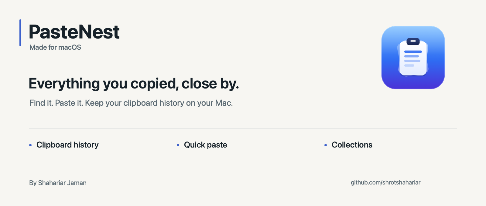
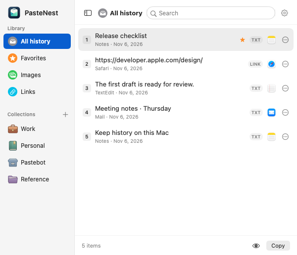
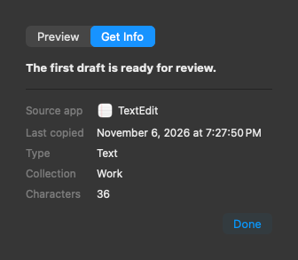

<picture>
  <source media="(prefers-color-scheme: dark)" srcset="banner-dark.png">
  
</picture>

<p align="center">
  <a href="https://github.com/shrotshahariar/PasteNest/releases/download/v1.9.4/PasteNest-1.9.4-macOS-arm64.zip"></a>
</p>
<p align="center"><strong>macOS 13+ · Apple silicon</strong><br>Local clipboard history · Application source is private</p>
<p align="center"><a href="https://github.com/shrotshahariar/PasteNest/releases/latest">Release notes</a> · <a href="https://github.com/shrotshahariar/PasteNest/issues">Report an issue</a> · <a href="#install-on-a-mac">Installation</a></p>

---

## PasteNest

Your clipboard history, one shortcut away. Find text, links, images, and files you copied, then paste them into the app you are using.

## Download

**[Download PasteNest for macOS](https://github.com/shrotshahariar/PasteNest/releases/download/v1.9.4/PasteNest-1.9.4-macOS-arm64.zip)** · [All releases](https://github.com/shrotshahariar/PasteNest/releases)

| Release | Requires | Mac support |
| --- | --- | --- |
| PasteNest 1.9.4 | macOS 13 or later | Apple silicon |

## Install on a Mac

1. Download the ZIP, extract it, and move **PasteNest.app** into **Applications**.
2. Open the app. This release is ad-hoc signed and has not been notarized by Apple.
3. If macOS blocks it, open **System Settings → Privacy & Security → Open Anyway**, then confirm that you want to open this downloaded app.

Updating? Quit the running app first, then replace the copy in Applications.

For one-click paste, allow **PasteNest** in **System Settings → Privacy & Security → Accessibility**. Manual Copy and ⌘V are also available.

## A look inside

<table>
<tr><td width="65%"></td><td width="35%"></td></tr>
<tr><td><strong>Find and paste.</strong> Search your history, choose a collection, or pick a recent copy.</td><td><strong>Know what you saved.</strong> Inspect a clip’s source, copy time, type and preview.</td></tr>
</table>

<sub>These demo screenshots show an earlier interface. Version 1.9.4 adds refreshed artwork, optional themes, a Files filter and date sections.</sub>

## What it does

| When you want to… | PasteNest helps you… |
| --- | --- |
| Bring back a previous copy | Open the picker with **⌘⇧Space**, search, and press Return. |
| Keep useful clips close | Use favorites and collections; reused clips move to the top. |
| Move files and images | Drag clips into compatible apps. Original files must remain available. |
| Paste a folder into an upload field | Prepare it as a ZIP for compatible destinations. |
| Clean up copied text | Paste as plain text, extract links, or apply local text transforms. |
| Make it your own | Choose themes, change the shortcut, set retention, and open at login. |

See the [full guide](GUIDE.md) for clipboard formats, drag and drop, filters, and storage details.

## Privacy and capture controls

**Personal and sensitive copies are saved by default, including repeats.** Use **Pause capture**, **Ignored apps**, or **Skip sensitive copies** to control future capture. Sensitive filtering recognizes some sources and markers; unmarked personal text can still be saved.

History stays in `~/Library/Application Support/PasteNest/` with owner-only permissions. There is no account or cloud service. History files are unencrypted and Mac backups can include them. New installations keep clips until you delete them; optional retention expires ordinary items after 1, 7, 30, or 90 days. Favorites and collections remain until deleted.

macOS exposes only the current clipboard, so a copy overwritten before PasteNest reads it can be missed.

## Verify your download

Download `SHA256SUMS.txt` alongside the ZIP from the [release page](https://github.com/shrotshahariar/PasteNest/releases/latest), then run in that folder:

```sh
shasum -a 256 -c SHA256SUMS.txt
```

## Support

[Report a bug or request a feature](https://github.com/shrotshahariar/PasteNest/issues). Include your app version, macOS version, and the destination app for paste or drag problems. Avoid including personal clipboard contents.

This repository contains compiled releases and documentation. Application source is private.

Made by [Shahariar Jaman](https://github.com/shrotshahariar).
