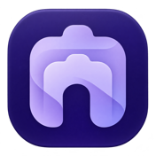
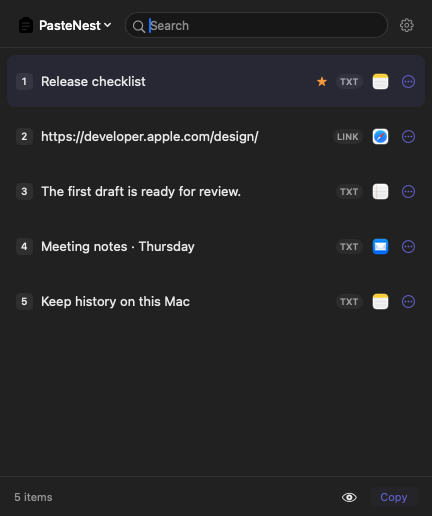

<p align="center"></p>

# PasteNest

A local clipboard history for macOS. Open the menu-bar picker, find something you copied, and click once to paste it back into the app you were using.

**[Download PasteNest 1.0 for Apple Silicon](https://github.com/shrotshahariar/PasteNest/releases/download/v1.0.0/PasteNest-1.0-macOS-arm64.zip)** · [Release notes and checksum](https://github.com/shrotshahariar/PasteNest/releases/tag/v1.0.0)

<p></p>

## Getting started

1. On an Apple Silicon Mac running macOS 13 or later, download the ZIP, extract it, and move **PasteNest.app** to Applications.
2. Launch PasteNest and copy some text, a link, or an image.
3. Press **⌘⇧Space**. Search or use the arrow keys, then click a row or press Return. The picker opens on the display under your pointer.

For automatic insertion, allow the installed app under **System Settings → Privacy & Security → Accessibility**. Some macOS versions call this **Device Control and Data Access**. You can also use **Copy** and paste manually. This release is ad-hoc signed and has not been notarized by Apple. Gatekeeper may block the downloaded build.

## In the picker

- Search by text, source app, or collection. Source logos help distinguish similar entries.
- Use a row’s **…** menu to preview, favorite, organize, or delete a clip.
- Open the gear to choose a shortcut, switch appearance, pause capture, or ignore an app.
- Click outside to dismiss. Capture continues in the menu bar until you quit.

## What is stored

Your history stays in `~/Library/Application Support/PasteNest/`. The app uses no account or cloud service. It skips secure input, excluded sources, and clipboard items marked private or transient. History files are owner-readable and are not encrypted by the app. Mac backups can include them.

By default, recent history lasts 30 days with a limit of 500 unprotected items. Favorites and collections persist until you remove them. If you previously imported a Pastebot library, its separate local snapshots remain after clearing the searchable history.

## Verify the download

From the directory containing the downloaded ZIP and checksum file, run:

```sh
shasum -a 256 -c SHA256SUMS.txt
```

This repository distributes compiled releases and documentation. The application source is private.
